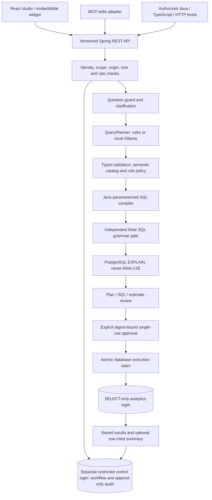

# QueryFence — Safe Natural-Language Analytics

A local Java/Spring Boot portfolio application for **synthetic retail data**. Ask a question, clarify ambiguity, inspect and edit a typed plan, review Java-compiled SQL and a PostgreSQL estimate, and explicitly approve execution. Optional summaries cite returned rows. No paid API or API key is required; the default planner is rules code, not an LLM.

QueryFence is a service that platforms can integrate with through supported REST, MCP or embedded interfaces. **It does not automatically connect to every platform.** Each host needs a supported API/plugin/MCP/custom-component surface, appropriate permissions and owner configuration.

## What this demonstrates

| Capability | Implementation |
| --- | --- |
| Business semantics | One Java `BusinessCatalog` supplies metric definitions to the UI, prompt and compiler |
| Clarification | Ambiguous/missing metrics, grouping or date windows return offered choices; no query is compiled until resolved |
| Editable review | Enum controls and 1–50 limit; saving creates a new version, SQL preview and estimate, invalidating prior approval |
| Role policies | Java checks metric, grouping and category/region scope on plan, edit, approval and execution |
| Independent SQL gate | A finite, full-statement SELECT grammar independently checks SQL and parameter types; no arbitrary SQL input endpoint |
| Scope/cost estimates | Prepared `EXPLAIN (FORMAT JSON)` without `ANALYZE`; configurable cost and scan-node-row budgets |
| Adversarial regression | Versioned injection, unsupported-domain, role and unsafe-plan/SQL fixtures |
| Grounded summaries | Deterministic optional summaries cite row numbers/values; no model inference or further analytics query |
| Persistent audit | Plans, edits, identity, roles, versions, approval, results, decisions and timing survive restart |
| Evaluation dashboard | Run actual measurements on 84 labeled questions, save a completed baseline and compare matching model/dataset versions |
| Integrations | Scoped/revocable opaque credentials, versioned REST/OpenAPI, separate stdio MCP server, web component and Java/TypeScript examples |

The original IntelliJ starter files outside this directory are preserved. Open `api/pom.xml` as the Maven project.

## Architecture and safety boundary



The model proposes enum fields only. It cannot choose tables, columns, operators, expressions, joins, filters outside the catalog or executable SQL. Java binds every selected value with prepared statements. SQL is gated again before EXPLAIN/execution, and PostgreSQL independently denies analytics writes. These are implemented boundaries, **not security certification**. See [SECURITY.md](docs/SECURITY.md) for limitations, including privileged Flyway credentials in the local API process.

Stack: Java 21 target, Spring Boot 3.5.7, Maven, Web/Validation/JDBC, Flyway, PostgreSQL 17.6 and springdoc 2.8.14; React 19.1.1, TypeScript 5.9.2, Vite 6.4.5, Vitest 4.1.11 and React Testing Library. Direct versions are pinned; npm lockfiles pin transitive packages. The MCP adapter uses Node's standard streams and the official protocol's tools subset; no cloud provider or paid dependency is needed.

## Start a fresh checkout

Prerequisites: Docker Desktop in Linux-container mode (or Docker Engine + Compose), ports 3000, 8080 and 5432 available. First builds need internet access for images/dependencies. macOS/Linux setup uses OpenSSL for random passwords. Java/Node/Maven are needed only for host development, tests and optional integration examples.

Windows PowerShell, from the original project root:

```powershell
cd queryfence
powershell -ExecutionPolicy Bypass -File .\scripts\setup-env.ps1
docker compose config --quiet
docker compose up --build -d
docker compose ps
```

macOS/Linux:

```sh
cd queryfence
sh scripts/setup-env.sh
docker compose config --quiet
docker compose up --build -d
docker compose ps
```

Open **http://localhost:3000**. The scripts create random local passwords and a server-side local-demo proxy secret in ignored `.env`; they refuse to overwrite an existing file. Never commit `.env`, print full `docker compose config`, or reuse these demo credentials elsewhere. `.env.example` contains placeholders only. The browser receives no permanent proxy secret.

If 8080 is occupied, put `API_PORT=18080` in `.env`. This checkout already uses **18080** and preserves the unrelated service on 8080. The frontend and Swagger link use the same-origin proxy and continue working. Direct integration examples must use the chosen API port.

## Upgrade the existing v1 local database

Preserve the existing `.env` and volume. No database reset or data deletion is needed.

PowerShell:

```powershell
cd queryfence # omit if already here
powershell -ExecutionPolicy Bypass -File .\scripts\upgrade-env.ps1
docker compose up -d db
docker compose exec -T db sh /docker-entrypoint-initdb.d/02-control-role.sh
docker compose up --build -d
```

macOS/Linux:

```sh
cd queryfence # omit if already here
sh scripts/upgrade-env.sh
docker compose up -d db
docker compose exec -T db sh /docker-entrypoint-initdb.d/02-control-role.sh
docker compose up --build -d
```

The upgrade adds missing secrets without changing existing passwords. The role script enables the restricted control login on existing volumes. Flyway applies additive workflow/audit/version migrations. Fresh volumes initialize both logins automatically. `docker compose down` stops services and retains data. `docker compose down -v` deliberately deletes the synthetic database and audit history; use it only when you intend to discard them.

## Try the application

1. Start with ANALYST and `Revenue by category last 30 days`.
2. Try `Revenue by region` to receive date-window choices. Missing dates are clarified rather than assumed.
3. Inspect the plan, authoritative definition, prepared SQL, bound values and estimate. **Adjust plan** changes only supported fields and recompiles on save.
4. Check the explicit approval box, then **Run confirmed query**. The browser first approves the current digest, then submits the returned single-use approval token.
5. **Explain returned results** describes only stored rows with citations. **View results** restores an executed plan's stored results after refresh/restart.
6. Try FINANCE with `Return rate by month all time`: the backend denies the metric. Try OPERATIONS with `Order count by region all time for home in north`; omitted mandatory filters trigger clarification.
7. In **Evaluation & regression**, run the benchmark, save that completed run as baseline, then run again. No score appears before a measurement exists.

Demo roles are intentionally selectable simulations for a local portfolio. They are not user accounts. Integration roles are fixed by their credential and cannot be elevated by browser headers or plan JSON.

| Role | Metrics | Groupings | Category/region scope |
| --- | --- | --- | --- |
| ANALYST | All approved metrics | All approved groupings | All allow-listed values, optional filters |
| FINANCE | REVENUE, ORDER_COUNT | MONTH, CATEGORY, REGION | All allow-listed values, optional filters |
| OPERATIONS | ORDER_COUNT, RETURN_RATE | CATEGORY, REGION, STATUS | Explicit HOME/GROCERY and NORTH/SOUTH filters required; unfiltered access is denied |

### Dataset and query meanings

Exactly 1,000 deterministic synthetic orders, five categories, five regions and three statuses. Categories: ELECTRONICS, HOME, CLOTHING, GROCERY, SPORTS. Regions: NORTH, SOUTH, EAST, WEST, CENTRAL. Statuses: DELIVERED, PENDING, CANCELLED. No customer/company data is used.

Windows LAST_7_DAYS/LAST_30_DAYS/LAST_90_DAYS are inclusive and relative to **2026-01-31**, not the computer's current date; ALL_TIME is also supported. Revenue includes pending/cancelled amounts; return rate is returned matching orders divided by all matching orders, percent. The backend catalog is authoritative. Amounts have no assigned currency. Results sort by value descending and label ascending, limit 1–50.

The rules vocabulary supports `revenue`/`sales`, `order count`/`number of orders`/`how many orders`, `return rate`, `by month/category/region/status`, supported windows, one category, one region and `top N`/`limit N`. Extra unsupported constraints are rejected. Clarification offers missing/ambiguous fields instead of guessing. This intentionally constrained grammar is not general natural-language understanding.

### Estimate budgets

Configure `.env`:

```dotenv
QUERY_MAX_COST=10000
QUERY_MAX_SCAN_ROWS=100000
```

Recreate the API after changing settings: `docker compose up -d --force-recreate api`. To demonstrate blocking, temporarily use `QUERY_MAX_COST=0.01`, request a new plan, then restore the original value. Estimates use PostgreSQL planner cost units, **not milliseconds**. Scan rows are estimated rows at scan nodes after filters, not guaranteed physical rows/pages inspected. Budgets are rechecked before execution; estimates do not guarantee runtime. The database statement timeout remains five seconds.

## Optional local Ollama

Install Ollama separately; Compose never downloads a model:

```sh
ollama pull qwen2.5:3b
ollama serve
```

Do not start a second server if the desktop app already serves 11434. Configure `.env`:

```dotenv
PLANNER_MODE=ollama
OLLAMA_MODEL=qwen2.5:3b
OLLAMA_MODEL_VERSION=unverified
OLLAMA_URL=http://host.docker.internal:11434
```

Then `docker compose up -d --force-recreate api`. If you record a model digest from your Ollama installation, set `OLLAMA_MODEL_VERSION` to that label. It is owner-supplied provenance; QueryFence does not verify the loaded weights against it. Reports explicitly label unknown versions as unverified. Mutable model tags alone do not establish identical weights across runs.

On Linux, host Ollama may need `OLLAMA_HOST=0.0.0.0:11434` and a firewall limited to the Docker host/network. Host-run Java uses `OLLAMA_URL=http://localhost:11434`. Choose a model appropriate for available memory. Calls have connection and full-response timeouts and a bounded response body. Invalid output or provider errors return errors; there is **no silent fallback**. Clarification/edit controls intentionally allow a user to choose a Java-validated plan without inference; edited/clarified plans record that source separately from model-generated proposals.

## Stable integration REST API

Use **`/api/v2`** for new integrations. The `/api/v1` analytics aliases use the same v2 policy/approval path; the old execute-with-only-`confirmed` request is intentionally no longer accepted. Evaluation endpoints are v2 only.

| Method | Path under `/api/v2` | Scope / behavior |
| --- | --- | --- |
| GET | `/health` | Public liveness/configuration, not readiness proof |
| GET | `/schema` | `schema:read`; definitions and role permissions |
| POST | `/queries/plan` | `query:plan`; REVIEWED, BLOCKED or CLARIFICATION_REQUIRED |
| POST | `/queries/{id}/clarify` | `query:plan`; exactly the offered selections |
| GET | `/queries/{id}` | `query:plan`; review existing owned plan |
| PATCH | `/queries/{id}` | `query:plan`; typed replacement, new plan/version |
| POST | `/queries/{id}/approve` | `query:review`; `confirmed:true` and current `reviewDigest` |
| POST | `/queries/{id}/execute` | `query:execute`; existing `approvalToken` and `confirmed:true` |
| GET | `/queries/{id}/results?summary=true` | `query:results`; stored rows and optional deterministic summary |
| GET | `/queries/history` | `query:results`; latest 100 owned plans for role |
| GET | `/audit` | `audit:read`; latest 100 owned audit events for role |
| GET / POST | `/evaluations` | `evaluation:read` / `evaluation:run`; POST returns 202 and run ID |
| POST | `/evaluations/{id}/baseline` | `evaluation:run`; select an owned completed run, never submit scores |

Swagger is under **Developer resources** at http://localhost:3000/swagger-ui/index.html. The same-origin address is intentional; Nginx forwards it to Java. Direct API Swagger is `http://localhost:18080/swagger-ui/index.html` in this checkout. [Generated OpenAPI snapshot](docs/openapi-v2.json) documents schemas; the live schema at `/v3/api-docs` is authoritative. Errors contain timestamp, code, safe message and correlation ID; headers include `X-Request-ID`. Relevant statuses: 400 invalid fields, 401 invalid/expired/revoked auth, 403 role/scope/origin, 404 unknown/not-owned plan, 409 stale/replayed state, 410 expiry, 413 size, 422 unsupported/SQL/cost rejection, 429 limits, 502 provider and 503 storage failures.

### Owner-issued scoped credentials

Node 22.20+/24 and a running migrated Compose database are required for the owner CLI:

```sh
node scripts/credentials.mjs create analyst-client ANALYST schema:read,query:plan,query:review,query:execute,query:results none 1
```

This creates a credential valid for one hour and writes it once to ignored `.secrets/analyst-client.json`. Only SHA-256 of a random 256-bit token is stored in PostgreSQL. Use `none` for server clients that send no browser Origin header. For browser clients supply exact allowed origins instead. The CLI prints the credential ID/path, never the token. Restrict the `.secrets` directory's ACL on Windows; POSIX files are created with owner-only mode. Revoke using the printed UUID:

```sh
node scripts/credentials.mjs revoke CREDENTIAL_UUID
```

Roles/scopes/origins/expiry are checked on every request. `X-Demo-Role` cannot change an integration credential's role. Request size is 16 KiB; configurable per-identity and per-IP fixed-window limits return 429/Retry-After. Global allowed origins and credential-specific origins must both allow a browser caller. CORS is a browser control, not authentication against non-browser clients.

The default studio uses a generated server-side proxy secret on loopback. External callers must use bearer authentication against the direct API, not borrow the anonymous local-demo proxy. Before any non-local deployment, set `DEMO_ENABLED=false`, remove the demo proxy path/secret and put the API behind owner-operated TLS/authentication infrastructure. This project is not supplied as an internet-ready deployment.

### Working REST example (PowerShell)

Browser demo access is separately limited to `DEMO_ORIGINS` (the studio/Vite origins by default). Adding a portal to global CORS does not grant it the studio proxy identity; its bearer credential is still required. Keep portal origins out of `DEMO_ORIGINS`. Requests without Origin remain a local trusted-proxy convenience, not an externally deployable authentication scheme.

Run from `queryfence/`, using 18080 here; use 8080 if that is your configured port:

```powershell
$credential = Get-Content .secrets/analyst-client.json -Raw | ConvertFrom-Json
$headers = @{ Authorization = 'Bearer ' + $credential.token }
$base = 'http://localhost:18080/api/v2'
$plan = Invoke-RestMethod "$base/queries/plan" -Method Post -Headers $headers -ContentType application/json -Body '{"question":"Revenue by category last 30 days"}'
$plan | ConvertTo-Json -Depth 8
if ((Read-Host 'Review the plan and estimate. Type APPROVE to run') -eq 'APPROVE') {
  $approvalBody = @{ confirmed = $true; reviewDigest = $plan.reviewDigest } | ConvertTo-Json
  $approval = Invoke-RestMethod "$base/queries/$($plan.planId)/approve" -Method Post -Headers $headers -ContentType application/json -Body $approvalBody
  $executeBody = @{ confirmed = $true; approvalToken = $approval.approvalToken } | ConvertTo-Json
  Invoke-RestMethod "$base/queries/$($plan.planId)/execute" -Method Post -Headers $headers -ContentType application/json -Body $executeBody
  Invoke-RestMethod "$base/queries/$($plan.planId)/results?summary=true" -Headers $headers
}
```

Clarification body: `{"selections":{"timeWindow":"ALL_TIME"}}`. Edits PATCH the full typed plan, e.g. metric/dimension/timeWindow/category/region/limit/explanation returned in `plan`. SQL is never accepted. Approval expires with the ten-minute plan, binds identity/role/version/compiled query, and is consumed atomically before execution. A caller cannot execute a newly created plan with `confirmed:true` alone. The trusted host must actually obtain human consent; a boolean and digest are not proof that a human read a screen.

### Java, TypeScript and generic HTTP hosts

```powershell
cd integrations
npm.cmd ci
npm.cmd run build
cd ..
$env:QUERYFENCE_API_URL='http://localhost:18080/api/v2'
$env:QUERYFENCE_TOKEN_FILE=(Resolve-Path .secrets/analyst-client.json).Path
node integrations/dist/examples/rest-client.js
java integrations/examples/QueryFenceClient.java
```

macOS/Linux:

```sh
(cd integrations && npm ci && npm run build)
export QUERYFENCE_API_URL=http://localhost:18080/api/v2
export QUERYFENCE_TOKEN_FILE="$PWD/.secrets/analyst-client.json"
node integrations/dist/examples/rest-client.js
java integrations/examples/QueryFenceClient.java
```

Both clients print the plan and require typing APPROVE. They do not print access or approval tokens. The TypeScript client exposes schema/plan/clarify/edit/review/approve/execute/results methods and accepts a runtime token provider. [Generic webhook/API request](integrations/examples/webhook-request.json) is a plan-only template for hosts that support outgoing HTTP. Its owner must replace the token placeholder from a secret store and implement review; a webhook is not an approval bypass.

## MCP-compatible hosts

The separate `integrations/mcp` server uses newline-delimited JSON-RPC on stdio, targeting the [official 2026-07-28 specification](https://modelcontextprotocol.io/specification/2026-07-28/basic/transports/stdio). It supports per-request version/capability metadata, discovery, deterministic tools/list, tools/call, protocol errors and cancellation. Legacy **2025-11-25** clients can explicitly negotiate initialize. Other revisions/transports/features are not claimed.

Tools: `get_schema`, `create_query_plan`, `clarify_query_plan`, `get_query_plan`, `execute_approved_plan`, `get_query_results`. **There is no approval tool.** Use separate credentials sharing an owner-chosen subject and role:

```sh
node scripts/credentials.mjs create host-mcp ANALYST schema:read,query:plan,query:execute,query:results none 1 portfolio-host
node scripts/credentials.mjs create host-reviewer ANALYST schema:read,query:plan,query:review,query:results none 1 portfolio-host
```

The last argument is the stable integration subject. Tokens are independently revocable; sharing a subject/role intentionally shares that application's plans. Keep the reviewer token in a trusted human review service, outside the model's context. A human reviews the plan there; that service sends `/approve` and passes the resulting single-use approval token to the host. The MCP execution token itself receives 403 if it tries to approve through REST. Do not grant it `query:review`.

Generic client configuration (adapt absolute paths and API port to your machine and the client's supported configuration format):

```json
{
  "mcpServers": {
    "queryfence": {
      "command": "node",
      "args": ["C:/Users/valle/IdeaProjects/QueryFence/queryfence/integrations/dist/mcp/server.js"],
      "env": {
        "QUERYFENCE_API_URL": "http://localhost:18080/api/v2",
        "QUERYFENCE_TOKEN_FILE": "C:/Users/valle/IdeaProjects/QueryFence/queryfence/.secrets/host-mcp.json"
      }
    }
  }
}
```

No raw token belongs in source/configuration committed to Git. Configure the host's normal confirmation UI as well. See [integration security and compatibility details](docs/INTEGRATIONS.md).

## Embeddable web component

The standalone `<query-fence>` custom element uses Shadow DOM and the same REST boundary. It supports runtime API URL/token provider, light/dark theme, expected credential role and host origin allow-list. It supports clarification, plan/SQL/cost review and explicit approval/execution. The main studio additionally supplies editable controls and evaluation UI.

1. Add `http://localhost:8085` to `ALLOWED_ORIGINS` in `.env` and recreate the API: `docker compose up -d --force-recreate api`.
2. Issue a **short-lived** browser credential:

```sh
node scripts/credentials.mjs create portal-widget ANALYST schema:read,query:plan,query:review,query:execute,query:results http://localhost:8085 1
(cd integrations && npm ci && npm run build && node scripts/serve-example.mjs)
```

On PowerShell run the last line as separate `cd integrations`, `npm.cmd ci`, `npm.cmd run build`, `node scripts/serve-example.mjs` commands. Open http://localhost:8085/examples/widget-host.html. Enter the configured API URL and the short-lived token from the ignored file in the password field. This local example keeps it only in memory. A real host should supply a short-lived token from its authenticated backend, using its own user/session controls.

```typescript
import './dist/widget/query-fence.js';
document.querySelector('query-fence').configure({
  apiUrl: 'https://your-owner-configured-queryfence.example/api/v2',
  theme: 'dark',
  role: 'ANALYST',
  allowedOrigins: ['https://your-portal.example'],
  getAccessToken: async () => {
    const response = await fetch('/your-authenticated-token-endpoint', {credentials:'same-origin'});
    if (!response.ok) throw new Error('Sign in required');
    return (await response.json()).accessToken;
  }
});
```

That token endpoint belongs to the host and is not magically supplied by QueryFence. Never put a permanent secret in widget attributes, JavaScript bundles, localStorage or query strings. Host CSP must permit the module/stylesheet origins and `connect-src` for the API; the example uses external scripts/styles and an explicit local CSP. For real deployment set CSP response headers, including appropriate `frame-ancestors`, and configure backend CORS and credential origins. Tokens do not make an untrusted/XSS-compromised host safe.

## Platform compatibility

| Host capability | Integration surface | Owner work required |
| --- | --- | --- |
| Server can send HTTP | REST / TypeScript / Java / generic API template | Store scoped credentials, handle clarification/review/approval, configure API access |
| MCP-compatible client can launch stdio servers | Separate MCP adapter | Build adapter, configure process/token file and trusted review channel; supported protocol revision required |
| Website/portal permits custom scripts/components | Web component | Runtime short-lived token delivery, CORS/origin/CSP and role configuration |
| Platform supports a custom plugin/API connector | Its supported connector calling REST/MCP | Platform-specific implementation, installation and permissions |
| Closed platform with no supported extension/API surface | No automatic integration | Requires that platform's cooperation/support; do not claim compatibility |

## Tests and measured evaluation

Host tools: Java 21 preferred (Java 25 was also tested), Maven 3.9+, Node 22.20+/24, npm, and Docker for PostgreSQL tests. On Windows use `npm.cmd` if execution policy blocks `npm.ps1`. IntelliJ's bundled Maven can be used if `mvn` is not on PATH.

From `queryfence/`:

```sh
mvn -f api/pom.xml verify
mvn -f api/pom.xml -Dtest=WorkflowIntegrationTest,PostgresIntegrationTest test
(cd web && npm ci && npm test && npm run build)
(cd integrations && npm ci && npm test)
docker compose config --quiet
node scripts/smoke-v2.mjs
```

In PowerShell, run the parenthesized shell groups as separate `cd`, `npm.cmd` and `cd ..` commands; quote Maven's comma-separated `-Dtest=...` argument. Testcontainers explicitly skips if Docker is unavailable, so inspect skip counts. Docker 29's API floor is set in `api/src/test/resources/docker-java.properties`.

Protocol/widget tests require no live API; the live MCP test is explicit opt-in. After creating matching scoped credentials:

```powershell
$env:QUERYFENCE_LIVE_CLIENT_FILE=(Resolve-Path .secrets/host-mcp.json).Path
$env:QUERYFENCE_LIVE_REVIEWER_FILE=(Resolve-Path .secrets/host-reviewer.json).Path
$env:QUERYFENCE_API_URL='http://localhost:18080/api/v2'
cd integrations
npm.cmd test
```

For POSIX export the same variables to absolute file paths before `cd integrations && npm test`. The live test explicitly approves only synthetic SELECTs and verifies scope denial and replay rejection.

The dashboard runs `evaluation/benchmark-v2.json` (84 labeled questions) plus unsafe typed-plan/SQL boundary fixtures. `evaluation/adversarial-v1.json` versions the injection subset. `evaluation/baseline-demo-retail-v2.json` is an **actually measured** snapshot; it is not a target or hard-coded application score. The dashboard compares completed database runs only. Generated current reports are ignored. Regenerate fixtures with `node evaluation/generate-v2.mjs`; a semantic fixture change should receive a new dataset version.

The original 62-question `BenchmarkTest` remains a legacy planner regression: `mvn -f api/pom.xml -Dtest=BenchmarkTest test`. It is not the new clarification/policy benchmark. See [EVALUATION.md](docs/EVALUATION.md) for denominators, provider-error handling, version provenance and limitations, and [VERIFICATION.md](docs/VERIFICATION.md) for commands/results actually run.

## Development and troubleshooting

- **Host development:** export `.env` into the process environment; Spring does not load it automatically. PowerShell: `Get-Content .env | Where-Object { $_ -match '^[A-Z_]+=' } | ForEach-Object { $k,$v = $_ -split '=',2; Set-Item -Path "Env:$k" -Value $v }`. POSIX: `set -a; . ./.env; set +a`. Start only the database, configure control role on old volumes, stop Compose API/web if their ports conflict, then run `mvn -f api/pom.xml spring-boot:run`. Set `SERVER_PORT` to the same `API_PORT` used in `.env` (8080 if unset). In another terminal `cd web && npm run dev`. Vite reads the server-side demo secret and API port from parent `.env`; neither is bundled as a permanent browser credential. Add the Vite origin, e.g. `http://127.0.0.1:5173`, to `ALLOWED_ORIGINS` when needed.
- **Control login errors after upgrade:** preserve `.env` passwords, recreate `db` to load new environment settings, and run `02-control-role.sh`. Do not grant metadata writes to analytics. Inspect `docker compose logs api db`.
- **Stored password mismatch:** editing `.env` does not change existing roles. Restore the original analytics/owner values. The control-role script intentionally sets only its configured control password. Reset the volume only if you deliberately want to discard synthetic data/history.
- **401/403 integrations:** check expiry/revocation, required scope, stable subject/role ownership, global and credential origins, and expected role header. Browser demo role selection never changes an authenticated credential's role.
- **409/410:** fetch the latest plan, resolve edits/clarification and obtain a new explicit approval; never retry a consumed token. A compiler/catalog change invalidates old reviews. An API restart preserves completed rows but marks interrupted execution/evaluation work failed; it never reruns analytics automatically.
- **429:** wait for the next fixed minute or reduce traffic. `REQUESTS_PER_MINUTE` defaults to 120 per identity, with an additional per-IP bound. Caps are per API instance, not distributed limits.
- **Ollama connectivity/memory:** verify `ollama list`, model tag, local URL and Docker host access. Cold load can exceed the 30-second provider timeout. Use a smaller model or rules mode; no accuracy/latency claims are made for an unrun model.
- **Maven cache access:** use `-Dmaven.repo.local=/writable/path/m2` if the default cache is inaccessible. Java 25 may emit Mockito dynamic-agent warnings; Java 21 is preferred.
- **Swagger hostname:** the published server URL is relative so Try it out uses the same proxy/direct origin. It is developer documentation, not the main product screen.

## Portfolio wording and limits

“Extended a Java/Spring Boot analytics demo with a typed query-plan boundary, semantic catalog, clarification and editable review, role policies, an independent SQL gate, PostgreSQL EXPLAIN budgets, digest-bound approvals, persistent audit metadata, scoped REST/MCP/widget integrations and automated regression tests.”

Describe measured results with dataset/model/version/sample counts and limitations. Do not claim production readiness, security certification, general natural-language accuracy, cost savings or business impact. Only synthetic data is supported. Runtime owner migration credentials, selectable local-demo roles, single-instance recovery/rate limits and non-tamper-proof owner-accessible audit storage are explicit local-demo limitations.
