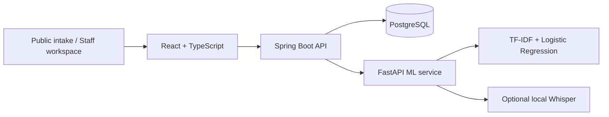

# CodeMix VoiceDesk

**Turn multilingual complaint text and voice recordings into structured cases that people can review, correct, and track.**

CodeMix VoiceDesk is a full-stack local research and demonstration application for complaint intake. It combines a public submission form, a staff review workspace, optional local speech recognition, and reproducible evaluation. Original model predictions are kept separate from human corrections so the review process can be inspected.

[Get started](#quick-start) · [Screenshots](#screenshots) · [Technical guide](voice-form-lab/README.md) · [Security](voice-form-lab/SECURITY.md)

## What it does

- **Public complaint intake:** Submit a complaint as text, record it in the browser, or upload a WAV file. The form includes consent and returns a submission receipt.
- **Staff review:** Inspect the extracted category, summary, location, date and time, and identifier. Correct the transcript and confirm each field.
- **Multilingual workflows:** Select Tamil, Telugu, Kannada, Malayalam, English, or Hindi. Generated text fixtures cover South Indian scripts and Romanized text with English cues.
- **Optional local speech recognition:** Run faster-whisper locally on a CPU after downloading a model. Sample transcript mode supports demonstrations without downloading a speech model.
- **Traceable corrections:** Preserve original predictions, evidence spans, and reviewer revisions. Export correction data as JSON.
- **Evaluation and dashboard:** Run the bundled synthetic corpus, inspect field errors and category metrics, and view activity calculated from stored cases.
- **Optional telephone intake:** The application includes a Twilio inbound-call integration. Twilio was explored using a free-trial account, but the phone integration has not been verified with a live call or with callers outside the trial setup. See [telephone intake limits](voice-form-lab/docs/PHONE_INTAKE.md).

Supported complaint categories are **water, electricity, roads, and sanitation**. Every extracted case requires human review.

## Screenshots

### Staff dashboard


### Field review


### Public complaint form


See also the [evaluation screen](voice-form-lab/docs/evaluation.png) and [mobile review](voice-form-lab/docs/mobile-review.png).

## Architecture



| Layer | Technologies |
| --- | --- |
| Frontend | React, TypeScript, Vite |
| Backend | Java 21, Spring Boot, Spring Security, JPA, Flyway |
| ML and speech | Python, FastAPI, scikit-learn, optional faster-whisper |
| Database | PostgreSQL 17 |
| Local deployment | Docker Compose, nginx |
| Checks | JUnit, Testcontainers, pytest, Vitest, Playwright |

## Quick start

Install Docker Desktop with Docker Compose and start its engine. From PowerShell:

```powershell
git clone https://github.com/vallemgopi/gopi-software-projects.git
cd gopi-software-projects/CodeMix-VoiceDesk/voice-form-lab
Copy-Item .env.example .env
notepad .env
```

Set your own `DB_PASSWORD` and `DEMO_PASSWORD` before starting. Use a demo password of at least 12 characters. Keep `.env` private and never commit it.

```powershell
docker compose up --build -d --wait
```

| Page | Local address |
| --- | --- |
| Staff workspace | http://localhost:5173 |
| Public complaint form | http://localhost:5173/complaint |
| API documentation | http://localhost:8080/swagger-ui/index.html |

Sign in to the staff workspace as `reviewer`, using the `DEMO_PASSWORD` you configured.

### Try the review workflow

1. Create a case and choose **Use synthetic sample transcript**.
2. Select **Extract & review**.
3. Inspect the evidence, correct any fields, and confirm every field.
4. Select **Save reviewed case**.
5. Open Evaluation to run the bundled corpus and export its report.

Text and sample transcript modes need no API keys, GPU, or pretrained model downloads. **Sample mode does not transcribe audio.** Real recording and upload transcription require the [local speech setup](voice-form-lab/docs/SOUTH_INDIAN_SETUP.md).

To inspect services or stop the application:

```powershell
docker compose logs -f api ml
docker compose down
```

Stopping with `down` preserves the database volume.

## Project structure

```text
CodeMix-VoiceDesk/
├── README.md
└── voice-form-lab/
    ├── api/                 # Java API, security, persistence, migrations
    ├── web/                 # Public form and staff React interface
    ├── ml/                  # Extraction, speech providers, evaluation data
    ├── scripts/             # Smoke checks and source packaging
    ├── docs/                # Setup guides, screenshots, verification records
    ├── compose.yml          # Local four-service deployment
    └── .env.example         # Configuration template
```

## Development and validation

Native development uses Java 21+, Maven 3.9+, Python 3.11 or 3.12, Node 24.15+ within the Node 24 series, and PostgreSQL 17. See the [technical guide](voice-form-lab/README.md#native-development-and-checks) for service startup and environment configuration.

Run these independently from `voice-form-lab` after installing dependencies:

```powershell
# Java checks; database integration tests require Docker
mvn -B -f api/pom.xml verify

# Python checks
Push-Location ml
pytest -q
Pop-Location

# Frontend checks
Push-Location web
npm ci
npm test
npm run build
Pop-Location
```

Browser and HTTP smoke checks require the services to be running. See the [verification notes](voice-form-lab/VERIFICATION.md) for recorded results and limitations.

## Scope and limitations

This is a **local research and demonstration build**. It is not hosted publicly, has no live telephone number configured, and does not dispatch complaints to an authority or provide emergency services.

Twilio was explored using a free-trial account. The phone integration has not been verified with a live call, callers outside the trial setup, or production number requirements. A live deployment would require an appropriately configured provider account and number, a publicly reachable HTTPS endpoint, and end-to-end testing. No live number or provider credentials are included in this repository. See [telephone intake activation and limits](voice-form-lab/docs/PHONE_INTAKE.md).

The category model trains on 96 synthetic examples. The bundled 44-example evaluation set shares templates and vocabulary with the training data, so its results do not establish real-world accuracy. Speech accuracy across accents and code mixing remains unvalidated. Confidence values are uncalibrated, and all fields require reviewer confirmation.

Docker Compose publishes application ports on localhost. Network deployment requires HTTPS, suitable identity and access controls, abuse protection, and a data-retention policy. Staff routes require authentication; designated public intake routes permit anonymous submissions. Original audio is not retained by default. Read the [security guidance](voice-form-lab/SECURITY.md) before sharing or deploying.

## Further documentation

- [Detailed setup, API routes, evaluation methodology, and troubleshooting](voice-form-lab/README.md)
- [South Indian language and speech setup](voice-form-lab/docs/SOUTH_INDIAN_SETUP.md)
- [Public intake behavior and hosting requirements](voice-form-lab/docs/PUBLIC_INTAKE.md)
- [Telephone intake activation and limits](voice-form-lab/docs/PHONE_INTAKE.md)
- [Security review](voice-form-lab/docs/SECURITY_REVIEW.md)

Maintained by [Gopi](https://github.com/vallemgopi).
