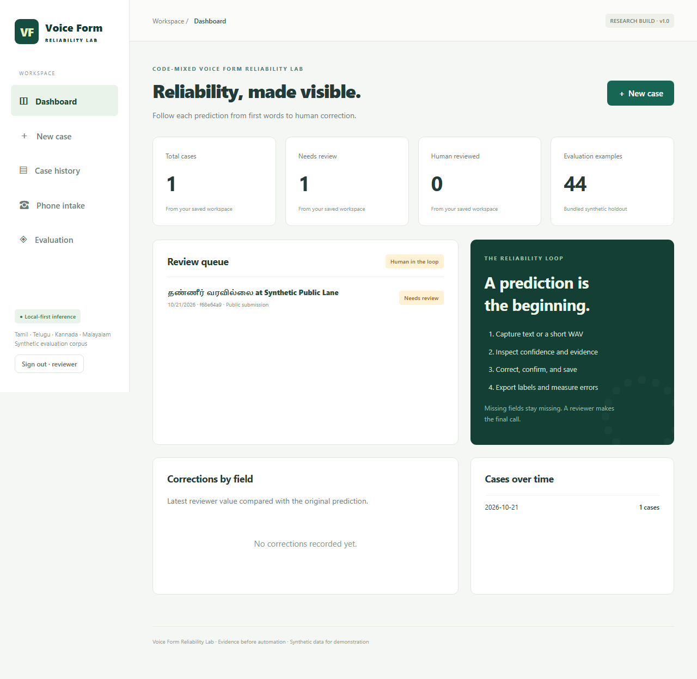

# Gopi's Software Projects

A collection of software projects by [Gopi](https://github.com/vallemgopi), with source code, setup instructions, and technical documentation.

## Projects

| Project | Description | Stack |
| --- | --- | --- |
| [CodeMix VoiceDesk](CodeMix-VoiceDesk/README.md) | Multilingual complaint intake through text and voice, with structured extraction, human review, and synthetic-data evaluation. | React, TypeScript, Java, Spring Boot, Python, FastAPI, PostgreSQL, Docker |

Two additional projects will be documented here when they are added.

## Explore CodeMix VoiceDesk



CodeMix VoiceDesk connects a public complaint form to a staff review workspace. Reviewers inspect extracted fields, preserve original predictions, and save corrections separately. Optional local speech recognition supports voice intake.

The application is a local research/demo build. Its bundled evaluation data is synthetic; internet hosting and a live telephone number are not configured.

**[View the project and setup guide →](CodeMix-VoiceDesk/README.md)**

## Getting started

```powershell
git clone https://github.com/vallemgopi/gopi-software-projects.git
cd gopi-software-projects
```

Open a project's folder and follow its README for prerequisites, configuration, and startup instructions. Keep passwords, API keys, and local environment files out of commits.

## Repository layout

```text
gopi-software-projects/
├── README.md
└── CodeMix-VoiceDesk/
    ├── README.md
    └── voice-form-lab/
```

## Author

[Gopi · GitHub](https://github.com/vallemgopi)
